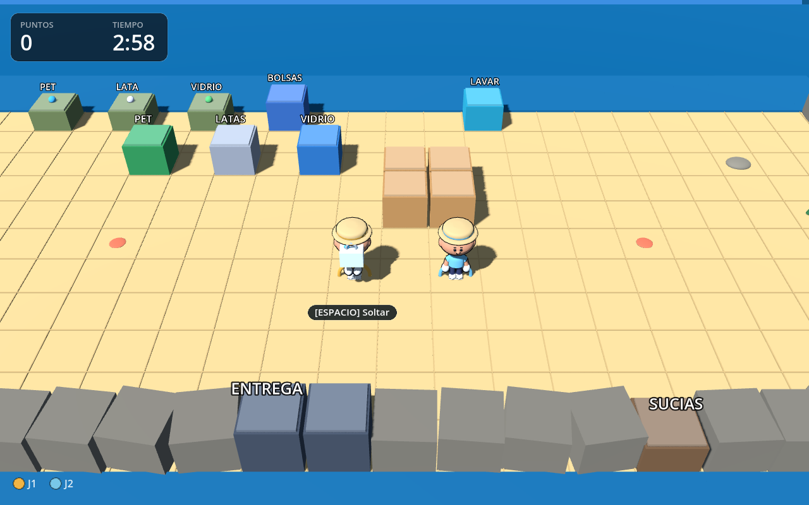

# Playa Limpia — prototipo 3D (Godot)

Prototipo jugable de **recolección y reciclaje en una playa**, con la estructura
de *Overcooked*: cooperación local, estaciones separadas, cámara en ángulo y
presión de tiempo.

Hecho en **Godot 4.7**, en **3D**. El personaje y los íconos son assets
generados (no modelados a mano): ver [assets](#assets).



## Requisitos

- **Godot 4.7** (probado con 4.7.2). 4.4+ debería funcionar.
  Binario: [godotengine.org/download](https://godotengine.org/download).
- Opcional: **Blender 4+** solo si querés regenerar el personaje.

## Jugar

```bash
git clone https://github.com/Catech124/playa-limpiar
cd playa-limpiar
godot --path .          # primera vez: importa los assets y abre el menú
```

O abrí `project.godot` desde el editor y presioná **F5**.
En el menú: **ENTER** = 1 jugador · **2** = cooperativo local · **D** = caja de
arena (sin reloj).

## Controles

| | Jugador 1 | Jugador 2 |
|---|---|---|
| Mover | `W A S D` | flechas |
| Acción (recoger / usar / tirar) | `ESPACIO` | `ENTER` |
| Impulso | `SHIFT` | `CTRL` |
| Lanzar | `E` | `.` |

`P` / `ESC` pausa · `R` reinicia.

## Cómo se juega (estado actual, v0.1)

1. **Recogé** un residuo del montón (PET / LATAS / VIDRIO).
2. **Tiralo en el contenedor** que corresponde: +4 puntos. Si no es el suyo, no
   entra y penaliza.
3. **Cargá una bolsa**: tomá una bolsa del dispensador, dejala en el mostrador y
   metele los residuos.
4. **Entregá** la bolsa en el camión; tiene que coincidir con un pedido.
5. **Lavá** las bolsas sucias: dejálas en el lavadero (pila de 3), se lavan solas
   y salen a una repisa de 3 (las gaviotas se las pueden robar).

> El rediseño a **cuota diaria** (basura tirada en la playa, reloj de 24 h,
> mar con tiburón, mundos) está diseñado y planificado en
> [`docs/DISENO-v2.md`](docs/DISENO-v2.md) y [`docs/PLAN-v2.md`](docs/PLAN-v2.md).
> Todavía **no** está implementado.

## Estructura

```
project.godot            configuración (escena principal, renderer, ventana)
scenes/Main.tscn         escena raíz mínima: todo se construye por código
scenes/ModelViewer.tscn  visor del personaje (3 copias girando)
assets/chef.glb          personaje low-poly (generado con Blender)
assets/ui/*.png          íconos del HUD (generados con Qwen, ver LICENCIAS.md)
scripts/config.gd        todos los números del juego (tuning)
scripts/levels.gd        mapa en texto + segundos de ronda
scripts/grid_world.gd    mapa de texto -> geometría 3D, colisiones y semántica
scripts/cell_data.gd     una celda: tipo, estación, ítem
scripts/carry_item.gd    residuo / bolsa (datos)
scripts/item_visuals.gd  geometría de los ítems
scripts/player.gd        movimiento, colisión, acción contextual y animación
scripts/main.gd          reglas, cámara de cooperativo, cuota/pedidos, estados
scripts/orders.gd        pedidos, paciencia, propina por rapidez
scripts/gulls.gd         gaviotas (roban bolsas / residuos)
scripts/hud.gd           HUD y pantallas, dibujados a mano
scripts/model_viewer.gd  visor standalone del asset
tools/gen_chef.py        generador del personaje (Blender headless -> GLB)
tools/render_views.py    4 vistas ortográficas + 3/4 para comparar
tools/ref_metrics.py     mide una lámina de referencia y el render propio
tests/headless_test.gd   37 comprobaciones de reglas (headless)
tests/shot.gd            capturas automáticas para verificación visual
docs/                    diseño, plan, especificación y comparaciones
```

## Personaje y animación

`assets/chef.glb` se **genera por script**: proporciones medidas sobre una lámina
de referencia (cabeza ancha, torso corto, ala del sombrero 0.59 de la altura),
~3.5k triángulos y 7 materiales. La remera y la cinta del sombrero se tiñen con
el color de cada jugador.

El GLB trae **bisagras** (`arm_l`, `arm_r`, `leg_l`, `leg_r`, `head`, `hat`): no
hay esqueleto ni animaciones importadas. `player.gd` las rota por código —
respiración en reposo, ciclo de caminata al moverse y brazos adelante al cargar.
Detalle en [`docs/ANIMACION.md`](docs/ANIMACION.md).

Verlo girando:

```bash
godot --path . scenes/ModelViewer.tscn
```

Regenerarlo (requiere Blender):

```bash
xvfb-run -a blender --background --python tools/gen_chef.py -- --sweep tools/sweeps/poses.json --out /tmp/out --export
cp /tmp/out/chef_game.glb assets/chef.glb
godot --headless --path . --import
```

## Assets

- **Personaje**: generado (Blender headless), script versionado.
- **Íconos del HUD**: `assets/ui/` — generados con el modelo de imágenes de Qwen
  y procesados a PNG transparente; origen en `assets/ui/LICENCIAS.md`.
- **Corpus de medición**: los modelos crudos de Kenney (92 MB) **no** se
  versionan (`.gitignore`); solo `corpus/features/` y `corpus/LICENCIAS.md`.

## Tests

```bash
godot --headless --path . -- --test
```

37 comprobaciones sobre las mismas funciones que usa el input real: recoger,
tirar en el contenedor, cargar la bolsa, entregar, lavar (pila + repisa),
colisiones (mesa, bolsa en el piso, muro), rig y animación. Sale con código 0 si
todo pasa.

Capturas (necesita display; funciona con Xvfb):

```bash
xvfb-run -a godot --path . -- --shot=/tmp/pl.png --demo2
```

Modos: `--demo`, `--demo2` (co-op), `--menu`, `--results`, `--facing`, `--carry`.

## Estado

v0.1 — prototipo de mecánicas en 3D, jugable de punta a punta. Lo que sigue
(cuota diaria, mar y tiburón, mundos) está en
[`docs/PLAN-v2.md`](docs/PLAN-v2.md).
