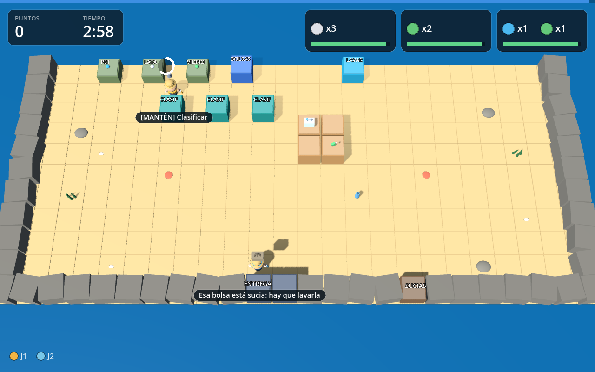
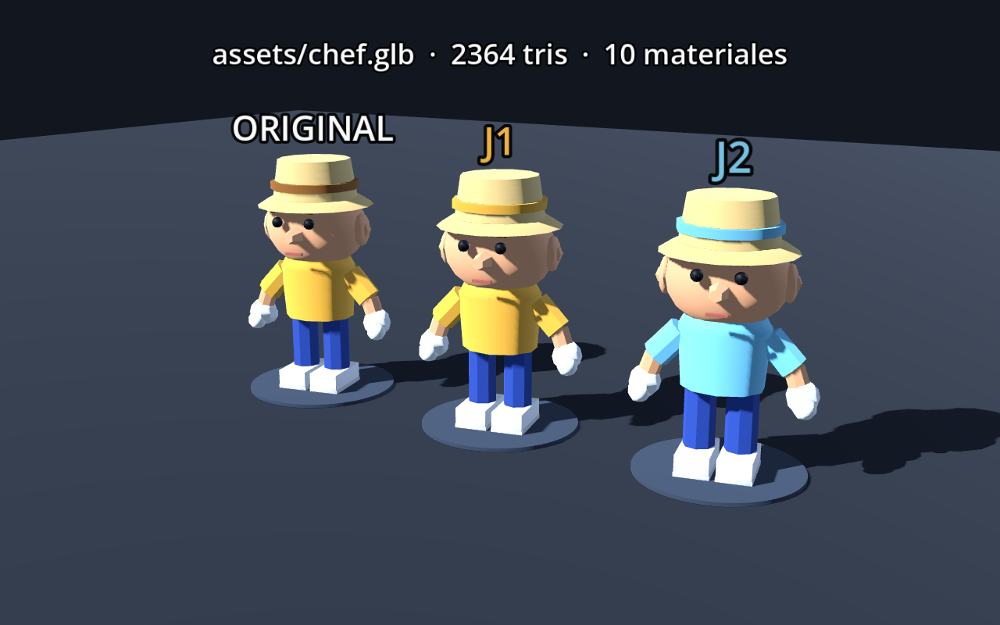

# Playa Limpia — prototipo 3D (Godot)

Prototipo jugable de **recolección de basura en una playa** con la estructura de
mecánicas de *Overcooked 2*: cooperación forzada, pedidos con reloj, estaciones
separadas y bolsas sucias que hay que lavar.

Hecho en **Godot 4.7**, en **3D** y con cámara fija en ángulo como Overcooked.
Sin assets: todo es geometría primitiva, color y luces.



## Requisitos

- **Godot 4.7** (probado con 4.7.2). Versiones 4.4+ deberían funcionar.
- Si no lo tenés: descargá el binario de
  [godotengine.org/download](https://godotengine.org/download) y descomprimilo.

## Jugar

```bash
godot --path .            # abre y corre el juego
```

O abrí `project.godot` desde el editor de Godot y presioná F5.

## Controles

| | Jugador 1 | Jugador 2 |
|---|---|---|
| Mover | `W A S D` | flechas |
| Acción | `ESPACIO` | `ENTER` |
| Impulso | `SHIFT` | `CTRL` |
| Lanzar | `E` | `.` |

`P` / `ESC` pausa · `R` reinicia · en el menú, `2` arranca co-op local y `D` abre
la caja de arena (sin reloj ni gaviotas).

## Cómo se juega

1. **Recogé** residuos de los montones (PET, latas, vidrio).
2. **Clasificá** en la mesa: mantené la acción 1,2 s.
3. **Cargá la bolsa**: dejá la bolsa en un mostrador y metele los residuos
   clasificados (capacidad 4).
4. **Entregá** la bolsa en el camión. Sólo vale si coincide exactamente con un pedido.
5. **Lavá**: cada entrega deja una bolsa sucia. Las bolsas son **finitas (5)**:
   si no lavás, te quedás sin bolsas.

## Estructura

```
project.godot          configuración (escena principal, renderer, ventana)
scenes/Main.tscn       escena raíz mínima: todo se construye por código
scenes/ModelViewer.tscn visor del personaje (3 copias girando)
assets/chef.glb        personaje low-poly (asset generado, ver abajo)
scripts/config.gd      TODOS los números del juego (tuning)
scripts/levels.gd      mapa en texto + props + segundos del sandbox
scripts/grid_world.gd  mapa de texto -> geometría 3D y semántica de celdas
scripts/cell_data.gd   una celda: tipo, estación, ítem
scripts/carry_item.gd  residuo / bolsa (datos)
scripts/item_visuals.gd geometría de los ítems
scripts/player.gd      movimiento, colisión, acción contextual, canales de trabajo
scripts/main.gd        reglas: fuentes, buffers, validación, entrega, estados
scripts/orders.gd      pedidos, paciencia, propina por rapidez
scripts/gulls.gd       gaviotas (el "ratón" de Overcooked)
scripts/hud.gd         HUD y pantallas, dibujados a mano
scripts/model_viewer.gd visor standalone del asset
tools/make_chef.py     generador del personaje (Blender headless -> GLB)
tests/headless_test.gd 24 comprobaciones de reglas (headless)
tests/shot.gd          capturas automáticas para verificación visual
DESIGN.md              ingeniería inversa de mecánicas + mapeo + números + roadmap
```

## El personaje (asset low-poly)



`assets/chef.glb` se genera por script (no está modelado a mano): proporciones de
Overcooked —cabeza grande, cuerpo chico, sombrero ancho— en ~3.000 triángulos y
9 materiales (`skin`, `shirt`, `shorts`, `hat`, `band`, `gloves`, `boots`,
`eyes`, `mouth`). La remera **y la cinta del sombrero** se tiñen con el color de
cada jugador, que es lo que los distingue desde la cámara alta.

Verlo girando, con las dos variantes de color:

```bash
godot --path . scenes/ModelViewer.tscn
```

Regenerarlo (requiere Blender 4+):

```bash
xvfb-run -a blender --background --python tools/make_chef.py
```

Eso reescribe `assets/chef.glb` y `docs/modelo-preview.png`. Los colores del
script se escriben en **hex sRGB** y se convierten a lineal: si se pasan floats
"a ojo", Blender los interpreta como lineales y el personaje sale casi blanco.


## Tests

**Reglas (sin ventana):**

```bash
godot --headless --path . -- --test
```

Corre 24 comprobaciones sobre las mismas funciones que usa el input real
(`player_use`, `player_channel`, `throw_item`): recoger, clasificar, fusionar en
la bolsa, entregar, rechazar, lavar, lanzar, expirar pedidos, fin de ronda y
reinicio. Sale con código 0 si todo pasa.

**Capturas (necesita display; funciona con Xvfb):**

```bash
xvfb-run -a godot --path . -- --shot=/tmp/pl.png --demo
```

Modos: `--demo`, `--demo2` (co-op), `--menu`, `--results`.

## Estado

v0.1 — prototipo de mecánicas en 3D. Lo implementado, lo que falta, las
decisiones y las preguntas abiertas están en [DESIGN.md](DESIGN.md).
