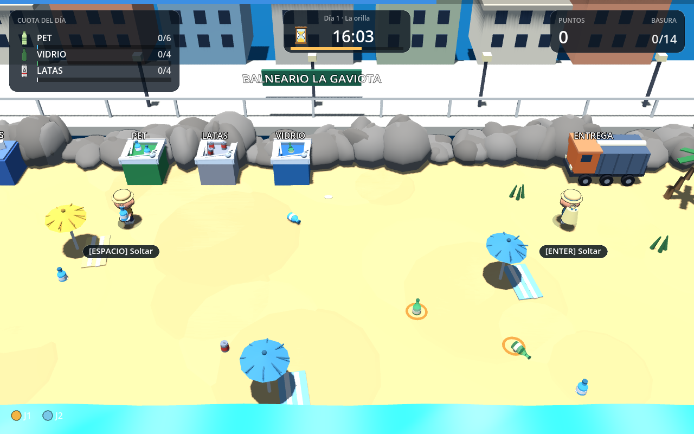
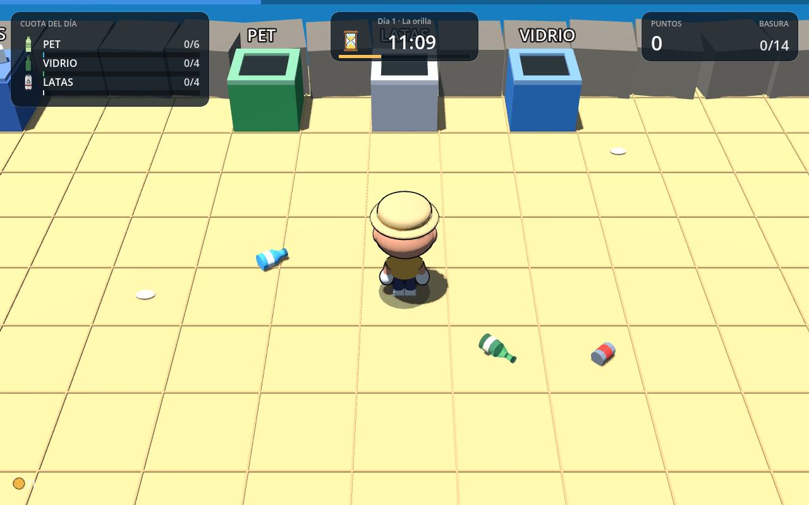
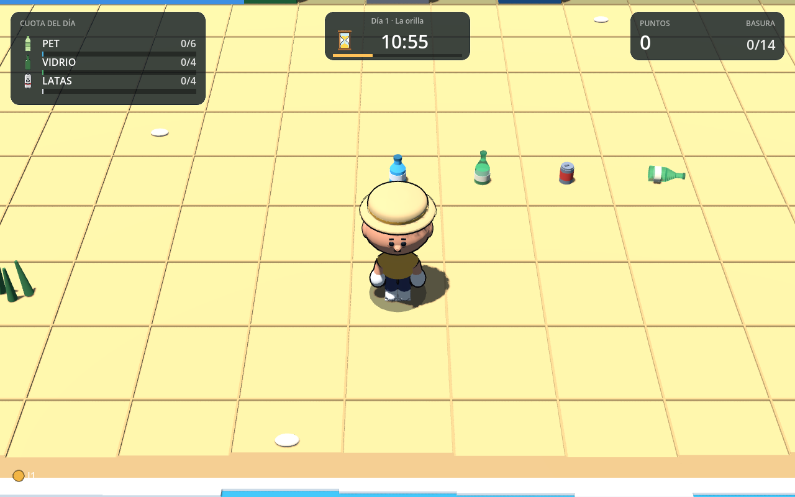
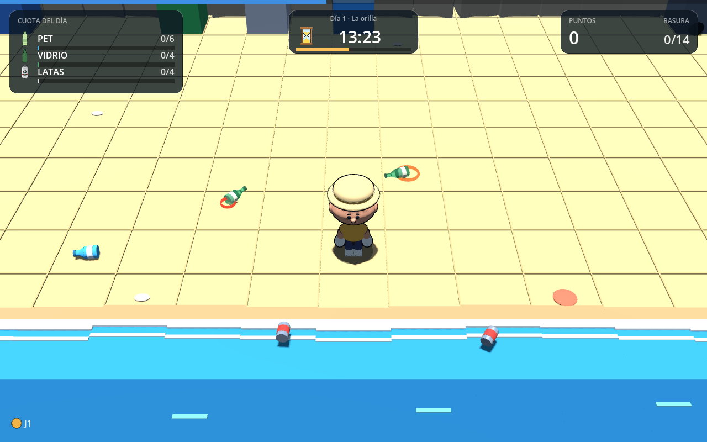
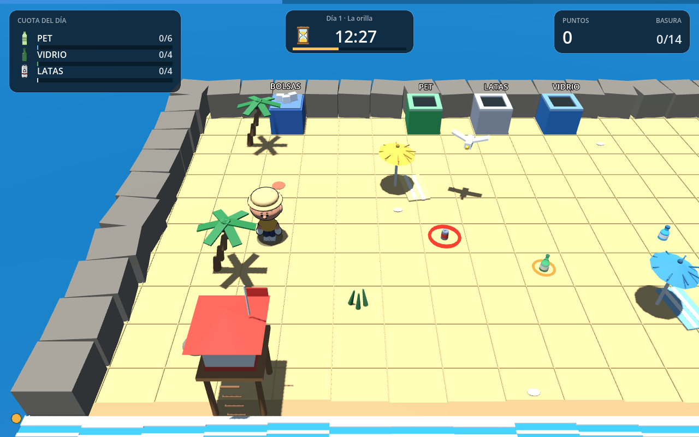
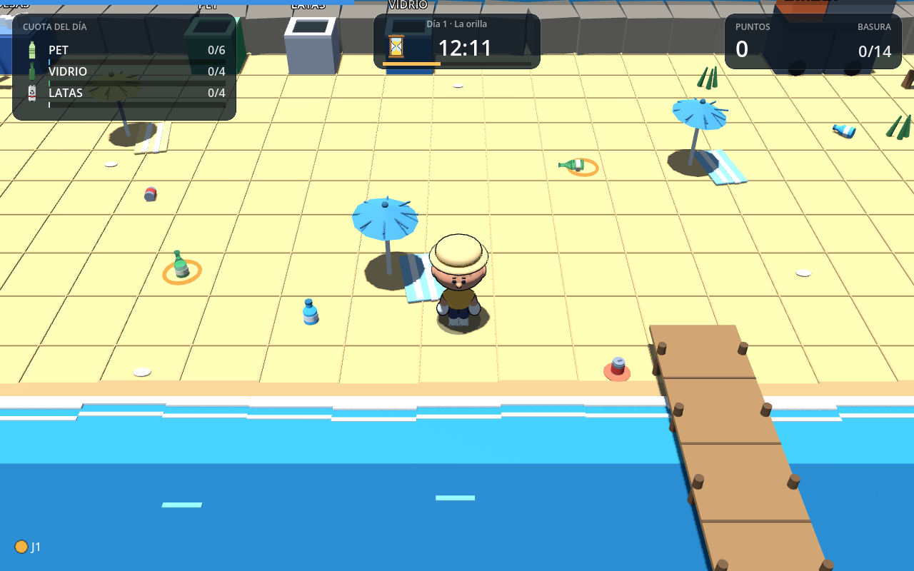
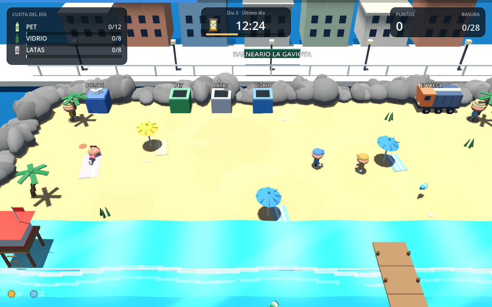
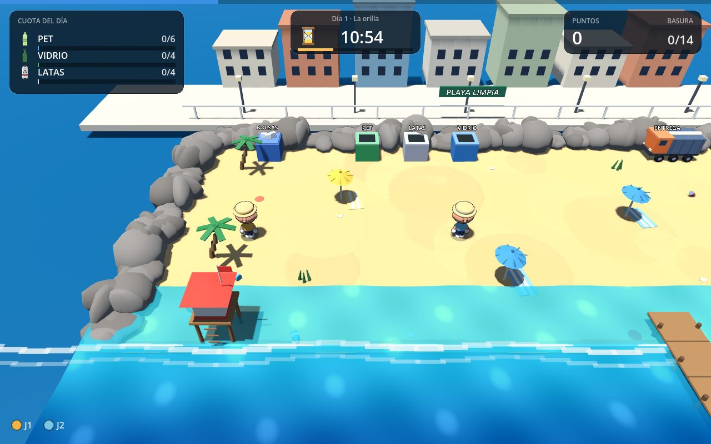
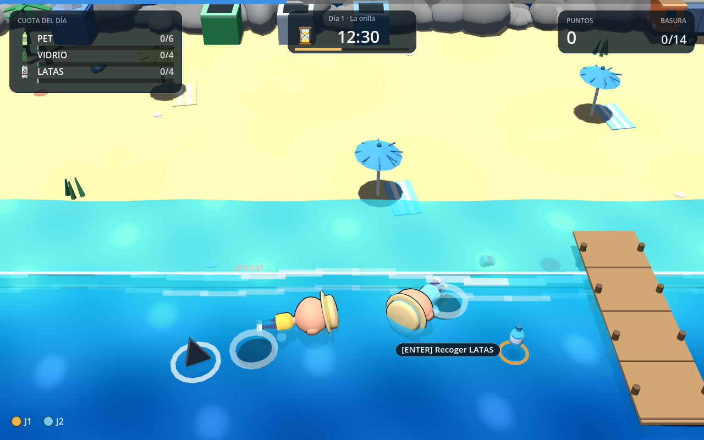
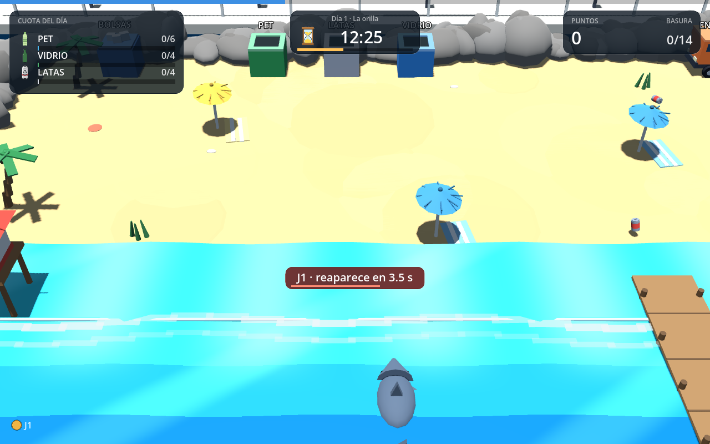

# Playa Limpia — prototipo 3D (Godot)

Prototipo jugable de **recolección y reciclaje en una playa**, con la estructura
de *Overcooked*: cooperación local, estaciones separadas, cámara en ángulo y
presión de tiempo.

Hecho en **Godot 4.7**, en **3D**. El personaje y los íconos son assets
generados (no modelados a mano): ver [assets](#assets).



## Requisitos

- **Godot 4.7** (probado con 4.7.2). 4.4+ debería funcionar.
  Binario: [godotengine.org/download](https://godotengine.org/download).
- Opcional: **Blender 4+** solo si querés regenerar el personaje.

## Jugar

```bash
git clone https://github.com/Catech124/playa-limpiar
cd playa-limpiar
godot --path .          # primera vez: importa los assets y abre el menú
```

O abrí `project.godot` desde el editor y presioná **F5**.
En el menú: **ENTER** = 1 jugador · **2** = cooperativo local · **D** = caja de
arena (sin reloj ni gaviotas).

## Controles

| | Jugador 1 | Jugador 2 |
|---|---|---|
| Mover | `W A S D` | flechas |
| Acción (recoger / colgar bolsa / tirar / entregar) | `ESPACIO` | `ENTER` |
| Impulso (casi sin espera) | `SHIFT` | `CTRL` |
| Lanzar | `E` | `.` |

Moverse en diagonal gira al personaje en diagonal (no se va de costado). El
impulso deja polvo (o salpicadura en el agua) y se puede repetir cada 0,35 s.
`P` / `ESC` pausa · `R` reinicia.

## Cómo se juega

La playa amanece cubierta de basura y hay que cumplir la **cuota del día** antes
del atardecer:

1. **Recogé** la basura que aparece tirada en la arena (PET, vidrio o latas).
   Se agarra lo que está cerca: no hace falta mirarlo.
2. **Colgá una bolsa** en la boca del contenedor que corresponde y tirá la basura
   adentro. Si el contenedor no es el suyo, no entra y perdés puntos.
3. Cuando la bolsa tiene **4 residuos** se marca llena: **retirala** y llevala.
4. **Entregala en el camión**: cada residuo suma a su barra de la cuota.

La basura es **física**: cae al aparecer, queda acostada y se puede **patear**.





La basura **no espera**: la que flota en el agua se hunde a los 6 s, el vidrio
de la arena se rompe a los 10 s y las **gaviotas** se llevan la que dejás tirada
(con un jugador aparecen cada ~50 s; con dos, cada ~34 s). Un **aro** que se
cierra avisa cuál está por perderse. Y el **reloj** no perdona: si se hace de
noche sin cumplir la cuota, se pierde el día.



La gaviota **marca con un aro rojo** el residuo que va a robar: hay unos segundos
para rescatarlo.





**Los NPCs** (1 a 3 según el día) son veraneantes: uno toma sol en su toalla,
otros charlan frente a frente y cada tanto uno se levanta, camina a la orilla y
**tira basura al mar**.



La playa tiene **palmeras, sombrillas con toalla, la torre del guardavidas y un
muelle** sobre el agua. Los props grandes bloquean el paso y reservan su celda:
la basura no aparece dentro de ellos. Detrás del paseo se ve la **ciudad**
(edificios, faroles y el cartel del balneario): el lugar no es una isla perdida.
La arena no tiene cuadrícula y el **mar es una lámina animada** con shader que
ondula y cambia de color según la profundidad.



Detalle de reglas y números en [`docs/MECANICAS.md`](docs/MECANICAS.md).

## Estructura

```
project.godot            configuración (escena principal, renderer, ventana)
scenes/Main.tscn         escena raíz mínima: todo se construye por código
scenes/ModelViewer.tscn  visor del personaje (3 copias girando)
assets/chef.glb          personaje low-poly (generado con Blender)
assets/ui/*.png          íconos del HUD (generados con Qwen, ver LICENCIAS.md)
scripts/config.gd        todos los números del juego (tuning)
scripts/levels.gd        mapa en texto, cuotas y ritmo de cada día
scripts/grid_world.gd    mapa de texto -> geometría 3D, colisiones y semántica
scripts/cell_data.gd     una celda: tipo, estación, ítem y bolsa colgada
scripts/carry_item.gd    residuo / bolsa (datos)
scripts/item_visuals.gd  geometría de los ítems
scripts/spawner.gd       tira basura en la playa, pesada por lo que falta de cuota
scripts/player.gd        movimiento, colisión, acción contextual y animación
scripts/main.gd          reglas, cámara de cooperativo, cuota, reloj y estados
scripts/gulls.gd         gaviotas (se llevan la basura tirada)
scripts/npcs.gd          NPCs que pasean y tiran basura
scripts/hud.gd           HUD y pantallas, dibujados a mano
scripts/model_viewer.gd  visor standalone del asset
tools/gen_chef.py        generador del personaje (Blender headless -> GLB)
tools/render_views.py    4 vistas ortográficas + 3/4 para comparar
tools/ref_metrics.py     mide una lámina de referencia y el render propio
tests/headless_test.gd   108 comprobaciones de reglas (headless)
tests/shot.gd            capturas automáticas para verificación visual
docs/                    diseño, plan, mecánicas y comparaciones
```

## Personaje y animación

`assets/chef.glb` se **genera por script**: proporciones medidas sobre una lámina
de referencia (cabeza ancha, torso corto, ala del sombrero 0.59 de la altura),
3.4k triángulos y 7 materiales. La cara (v3) está medida contra la lámina con
`tools/cara_metrics.py`: ojo 0.055 del ancho de cabeza, alto/ancho 1.2 y dos
brillos en unidades absolutas. Ver [`docs/CARA-v3.md`](docs/CARA-v3.md). La remera y la cinta del sombrero se tiñen con
el color de cada jugador.

El GLB trae **bisagras** (`arm_l`, `arm_r`, `leg_l`, `leg_r`, `head`, `hat`): no
hay esqueleto ni animaciones importadas. `player.gd` las rota por código —
respiración en reposo, ciclo de caminata al moverse y brazos adelante al cargar.
Detalle en [`docs/ANIMACION.md`](docs/ANIMACION.md).

Verlo girando:

```bash
godot --path . scenes/ModelViewer.tscn
```

Regenerarlo (requiere Blender):

```bash
xvfb-run -a blender --background --python tools/gen_chef.py -- --sweep tools/sweeps/poses.json --out /tmp/out --export
cp /tmp/out/chef_game.glb assets/chef.glb
godot --headless --path . --import
```

## Assets

- **Personaje**: generado (Blender headless), script versionado.
- **Íconos del HUD**: `assets/ui/` — generados con el modelo de imágenes de Qwen
  y procesados a PNG transparente; origen en `assets/ui/LICENCIAS.md`.
- **Corpus de medición**: los modelos crudos de Kenney (92 MB) **no** se
  versionan (`.gitignore`); solo `corpus/features/` y `corpus/LICENCIAS.md`.

## Tests

```bash
godot --headless --path . -- --test
```

**108 comprobaciones** sobre las mismas funciones que usa el input real: reloj y
cuota, basura que aparece, colgar / sacar la bolsa del contenedor, tirar basura
(tipo correcto y equivocado), entrega en el camión, fin de día (ganar y perder),
gaviotas (incluido que aparezcan más espaciadas con un solo jugador),
colisiones (contenedor, bolsa en el piso, muro, mar), física de la basura
(cae acostada, se patea, se congela en la mano), agarre por cercanía, giro
diagonal, presión (se hunde, se rompe, tope de castigos), rig y animación.
Sale con código 0 solo si pasa todo.

Capturas (necesita display; funciona con Xvfb):

```bash
xvfb-run -a godot --path . -- --shot=/tmp/pl.png --demo2
```

Modos: `--demo`, `--demo2` (co-op), `--items` (los tres residuos de cerca),
`--kick` (basura pateada), `--pressure` (aros y basura flotante),
`--map` (el mapa entero), `--diagonal` (giro en diagonal), `--swim` (nado y
aleta), `--bite` (mordida del tiburón y cuenta atrás), `--npc` (NPCs tirando basura), `--gull` (aro de la gaviota),
`--shore` (orilla), `--closeup` (contenedores con bolsa), `--menu`, `--results`,
`--win`, `--facing`, `--carry`.

## Estado

**v0.5 — Fases 1 a 4 del rediseño completas**: bucle de cuota (basura tirada →
contenedor con bolsa → camión), reloj de 24 h, HUD con las 3 barras, fin de día
con estrellas y la presión de la Fase 2 (se hunde, se rompe, gaviota, aros y tope
de castigos). Funciona la cooperación de 2 jugadores en el mismo teclado.

La **Fase 3** agrega el mar: se entra nadando (más lento), aparece la aleta y
después el tiburón muerde: no quita puntos, te deja **5 s fuera de juego** (con
cuenta atrás en pantalla) y reaparecés en el spawn del nivel. Cuanto más te quedás en el agua, antes vuelve. La basura
flotante suma doble a la cuota.



Si te quedás en el agua aparece el tiburón: sale, muerde y te deja unos segundos
fuera de juego con la cuenta atrás en pantalla.



Lo que queda en [`docs/PLAN-v2.md`](docs/PLAN-v2.md): el nivel bosque con río
(Fase 4.2), que reusa los mismos sistemas con otros datos.
