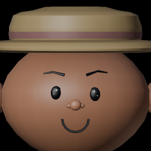
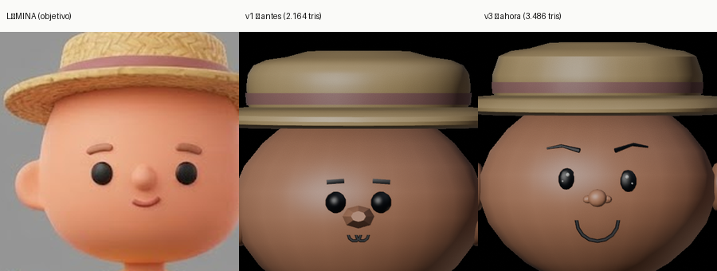

# Cara v3 — qué se cambió y cómo se mide

Estado: **2026-10-28**. Reemplaza la cara de `tools/gen_chef.py` (la v1 de 2026-09,
que sigue disponible con `"face": {"preset": "v1"}` para el A/B).

```
v1  ojos = dos esferas negras planas          → se leían como pegatinas
    cejas = cajas rectangulares
    nariz = cilindro de 8 caras con disco      → parecía hocico
    boca  = dos arcos sueltos (omega)
v3  ojos = negro ovalado + DOS brillos         → húmedo, mirando
    cejas = hoja de 3 segmentos, asimétricas
    nariz = botón + dos aletas hundidas
    boca  = línea de sonrisa torcida 2°
    orejas = pabellón integrado (sin aro suelto)
```




## Lo que hace que se lea "de personaje" (y no generado)

1. **Brillo en el ojo.** Dos reflejos en unidades absolutas (0.0058 y 0.0026), no
   proporcionales al radio: el reflejo de un ojo no encoge con el ojo. Sin brillo,
   un ojo negro es una pegatina.
2. **Asimetría de mano.** El ojo derecho 2 % más grande y 0.6 mm más bajo; la ceja
   derecha 4 mm más alta; la sonrisa girada 2°. La simetría perfecta es la firma
   de la máquina.
3. **Menos piezas.** La primera versión de la v3 puso esclerótica blanca + iris +
   pupila + párpado de bola por ojo: se leyó como "ojos hinchados". La lámina y
   Overcooked usan **ojo negro con brillo, sin blanco**. Se borraron el iris, la
   esclerótica, los pómulos, el mentón y el rubor como esferas sueltas: cada bola
   añadida era una protuberancia visible.
4. **Tamaño medido, no a ojo.** `tools/cara_metrics.py` mide la lámina y devuelve
   ratios: ojo **0.068** del ancho de cabeza, alto/ancho **1.20**, separación
   **0.309** (4.5 ojos entre centros). El ojo v1 (0.052 de radio) daba 0.095
   visibles: el doble de la referencia. Eso era lo que hacía la cara "de alien".

## Números

| Métrica | v1 | v3 | Lámina |
|---|---|---|---|
| Ojo visible / ancho de cabeza | 0.094 | 0.055 | 0.068 |
| Alto/ancho del ojo | 1.00 | 1.20 | 1.20 |
| Separación / ancho de cabeza | 0.34 | 0.26 | 0.31 |
| Triángulos | 2.164 | **3.486** | — |
| Materiales | 7 | 7 | — |
| Bisagras | 6 | 6 | — |

**Triángulos:** el spec pide **≤3.500** y la v3 queda en **3.486**. La primera
versión con rasgos en volumen salió en 6.816; el recorte se hizo **midiendo el
daño**, no a ojo (IoU de silueta + Δcolor entre renders del mismo encuadre):

| Recorte | Ahorro | Costo medido |
|---|---|---|
| Ojos 20×12 → 10×7 (miden 4 px a 45 px) | 544 | Δcolor 0.0 en la cara |
| Sombrero: perfil sin puntos redundantes | 336 | canto del ala se aplana → se restauraron 2 puntos |
| Cráneo 22×13 (se dejó) | 0 | a 16×10 el contorno se veía facetado en primer plano |
| Torso 30 → 12 segmentos | 324 | invisible (lo tapan los brazos) |
| Orejas 14×10 → 10×7 · cejas 8 → 6 vértices | 264 | invisible a 45 px y en close-up |
| Guantes, puntas de bota, cinta del sombrero, suelas | 264 | invisible |

Resultado global contra la versión de 6.816: **IoU de silueta 0.996 (cara) y 0.989
(sombrero) · Δcolor medio 1.8/255**. El único cambio perceptible es el facetado del
ala en un plano muy cercano, que es el compromiso del presupuesto.

**Regla que quedó:** el presupuesto de triángulos se gasta primero en la CARA
(ojos, cráneo) y se paga con lo que la cámara del juego no ve (torso bajo los
brazos, suelas, cinta). Al revés se ahorra igual y el personaje empeora.

## Regenerar

```bash
xvfb-run -a blender --background --factory-startup --python tools/gen_chef.py -- \
    --out /tmp/chef --export
cp /tmp/chef/chef.glb assets/chef.glb
godot --headless --path . --import
godot --headless --path . -- --test        # 101/101
```

Detalle de la cara en un render (no hace falta Blender one-shot: usa el servidor):

```bash
blender3d render assets/chef.glb --vistas "" \
    --detalle cara:frente:0,0,0.98:0.66 --out /tmp/cara
```

## La trampa que costó dos iteraciones

`superficie(P, x, z)` resuelve el punto del elipsoide para coordenadas **en
unidades** (`x²/a² + y²/b² + z²/c² = 1` → `y = -b·√(1 - x²/a² - z²/c²)`).

Antes se pasaban **direcciones normalizadas** como si fueran coordenadas:
`(1.79, -1, 0.5)` normalizado apunta 60° al costado, así que los ojos salían
pegados al borde de la cabeza y los pómulos en las sienes. Un helper con la
unidad equivocada no falla: produce un modelo plausible y equivocado.
